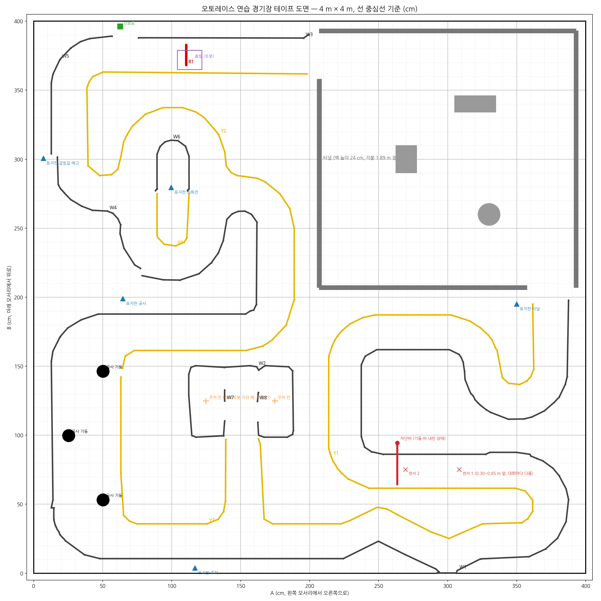

# 2026 STEAM Cup 오토레이스 — TurtleBot3 자율주행

**2026 STEAM Cup 오토레이스 대회** 출전용 저장소다. 오토레이스(AutoRace) v.2023.1 규칙의 여섯 미션을
TurtleBot3 Burger 로 완주하기 위한 ROS 2 워크스페이스다. Gazebo Harmonic 시뮬레이션에서 먼저 완주시키고, 같은 코드를 실제 로봇으로
옮기고 있다.

- ROS 2 **Jazzy**, Ubuntu 24.04, Gazebo Harmonic (gz-sim 8)
- 로봇: TurtleBot3 **Burger** (Raspberry Pi 4 + OpenCR, LDS-02 라이다), 카메라 2대 (전방 Pi 카메라: 표지판·신호, 하향 C920: 차선)

| 브랜치 | 내용 |
|---|---|
| `master` | 시뮬레이션. 코스, 미션 전체, 시뮬 파라미터 |
| [`real`](../../tree/real) | 실제 로봇. Pi 카메라·라이다 노드, 실차 파라미터, 카메라 거치대, 실차 도구 ([README](../../blob/real/README.md)) |



## 진행 상황 (2026-10-11)

| 단계 | 상태 |
|---|---|
| 시뮬레이션 | 신호등부터 터널까지 한 바퀴 완주. 10/7 부터는 실제 로봇의 속도·회전 한계로 달린다 |
| 실차 차선 주행 | 연습 코스에서 0.19 m/s. 커브는 오도메트리로 기억한 차선 가운데 경로를 따라 돈다 |
| 실차 표지판 | Pi 카메라로 좌·우회전과 주차 표지판 인식 (실물 표지판 모양에 맞게 판정 수정) |
| 실차 공사 구간 | 장애물 3 개를 세며 통과하고 마지막 장애물 옆에서 차선 주행으로 넘긴다 |
| 실차 주차 | 입구(왼쪽 노란선의 틈) 찾기와 진입로 주행을 만들었고, 코스에서 확인 중 |
| 실차 신호등·차단바·터널 | 실물 소품으로 아직 시험하지 않음 |

## 작업일지

코드를 여러 날 치를 한 번에 올린 때가 있어 커밋 이력만으로는 개발 순서가 보이지 않는다.
날짜별로 무엇을 왜 바꿨는지는 아래 일지에 있다.

| 일지 | 기간 | 내용 |
|---|---|---|
| [worklog_2026-09-30.txt](docs/worklog_2026-09-30.txt) | 9/30 | 시뮬: 대회 맵과 Burger 로 교체, 차선 인식, 끼임 감지 |
| [worklog_2026-10-01.txt](docs/worklog_2026-10-01.txt) | 10/1 ~ 10/2 | 시뮬: 갈림길 표지판·섬, 차선 추종 재작성, 갈림길·신호등 미션 |
| [worklog_2026-10-02.txt](docs/worklog_2026-10-02.txt) | 10/2 ~ 10/6 | 시뮬: 공사·주차·차단바·터널 미션, 한 바퀴 완주, 속도 |
| [`real` README 의 진행 과정](../../blob/real/README.md#진행-과정) | 10/7 ~ 10/9 | 실차: 로봇 올리기, 라이다 드라이버, 카메라 위치, 표지판, 기억한 경로, 튜닝 |
| [worklog_2026-10-09.txt](../../blob/real/docs/worklog_2026-10-09.txt) | 10/9 ~ 10/11 | 실차: 와이파이 끊김, 표지판 판정, 공사 미션, 차선 기억 비우기, 주차 입구·진입로, E-STOP·RViz 도구 |

## 미션

| 미션 | 하는 일 | 노드 |
|---|---|---|
| 신호등 | 정지선에 서서 녹색이 켜질 때 출발 | `traffic_light_mission` |
| 갈림길 | 좌/우 표지판을 읽고 그쪽 길로 | `intersection_mission` |
| 공사 구간 | 라이다로 장애물을 피해 통과 | `construction_mission` |
| 주차 | 빈 칸을 찾아 들어갔다 나오기 | `parking_mission` |
| 차단바 | 바가 내려오면 정지, 올라가면 통과 | `level_crossing_mission` |
| 터널 | 어두운 장애물 구간을 라이다로 빠져나오기 | `tunnel_mission` |

미션 순서는 대회 당일 공개되므로 하드코딩하지 않는다. `mission_manager` 가 표지판과 신호를
보고 미션을 바꾸고, 미션이 실패해도 차선 주행으로 돌아가 나머지를 계속한다. 30 초 정지는
경기 종료이므로 모든 정지 동작에 타임아웃과 탈출 동작이 있다. 자세한 설계는
[docs/DESIGN.md](docs/DESIGN.md).

## 구조

```
src/
  autorace_sim/         Gazebo Harmonic 코스, 신호등·차단바 구동, 로봇 모델, sim_firmware
                        (실제 로봇의 속도·회전 한계를 시뮬에 적용)
  autorace_perception/  BEV 투영(카메라 높이·피치로 계산), 차선·정지선·표지판·신호등·차단바 검출
  autorace_core/        mission_manager, 미션 6개, lane_controller(pure pursuit), cmd_vel_mux
  autorace_bringup/     런치 파일과 파라미터 (param/*_sim.yaml, real 브랜치에 *_real.yaml)
  autorace_msgs/        메시지 정의
docs/                   설계서, 시뮬 운영 메모, 코스 도면, 작업일지
hardware/venue_props/   연습 경기장 소품 3D 프린팅 모델(신호등, 차단바, 표지판)과 아두이노 펌웨어
```

`src/turtlebot3_autorace`, `src/turtlebot3_simulations` 는 ROBOTIS 원본으로,
`autorace.repos` 로 받아 온다 (저장소에는 들어 있지 않다).

## ROBOTIS 원본에서 가져온 코드

차선 인식 파이프라인의 두 노드는 ROBOTIS 의
[turtlebot3_autorace](https://github.com/ROBOTIS-GIT/turtlebot3_autorace) (`jazzy` 브랜치, 커밋 `d2442ca`, Apache 2.0)
를 포크해서 고쳤다. 원본 저작권 표시는 각 파일 머리말에 남겼다. 나머지 노드(미션들, `mission_manager`,
`lane_controller`, `cmd_vel_mux`, 표지판·신호등·차단바·정지선 검출, 시뮬 코스와 구동, 실차 라이다·카메라
드라이버)는 새로 썼다.

| 우리 파일 | 원본 | 줄 수 (원본 → master / real) |
|---|---|---|
| [`autorace_perception/bev_projector.py`](src/autorace_perception/autorace_perception/bev_projector.py) | [`turtlebot3_autorace_camera/image_projection.py`](https://github.com/ROBOTIS-GIT/turtlebot3_autorace/blob/d2442ca1670836db5fea6f4bfc649de929c4da0b/turtlebot3_autorace_camera/turtlebot3_autorace_camera/image_projection.py) | 245 → 163 / 163 |
| [`autorace_perception/detect_lane.py`](src/autorace_perception/autorace_perception/detect_lane.py) | [`turtlebot3_autorace_detect/detect_lane.py`](https://github.com/ROBOTIS-GIT/turtlebot3_autorace/blob/d2442ca1670836db5fea6f4bfc649de929c4da0b/turtlebot3_autorace_detect/turtlebot3_autorace_detect/detect_lane.py) | 624 → 589 / 833 |

**`bev_projector.py`**

- 그대로 둔 것: 카메라 영상을 위에서 본 영상으로 펴는 역할, 토픽 이름(`/camera/image_input` → `/camera/image_output`),
  출력 1000×600, 5×5 가우시안 블러, `cv2.warpPerspective` 로 펴기.
- 바꾼 것: 원본은 영상 위 사다리꼴 네 점(`top_x`, `top_y`, `bottom_x`, `bottom_y`)을 손으로 맞춰 호모그래피를 만든다.
  그 값은 카메라마다 다시 맞춰야 하고 결과 영상의 축척을 모른다. 여기서는 **카메라 높이·숙인 각도·앞쪽 위치와
  `camera_info` 의 내부 파라미터로 바닥 평면 호모그래피를 계산**한다. 출력이 1 m = 1200 px 의 고정 축척이고
  맨 아래 줄이 로봇 앞 몇 m 인지 안다. 카메라를 바꾸거나 다시 달면 숫자 세 개만 고친다 (시뮬과 실차가 같은 코드).
  보정 모드(사다리꼴 그리기)와 압축 영상 입력은 뺐다 (디코드는 `republish` 가 한다).

**`detect_lane.py`**

- 그대로 둔 것: 흰선·노란선을 HSV 범위로 찾는 방식과 파라미터 이름·기본값(`detect.lane.white.*`, `detect.lane.yellow.*`),
  잡힌 픽셀 수에 따라 밝기 하한을 5 씩 올리고 내리는 자동 조정, 선별 신뢰도(0~100) 토픽,
  호환용 출력 `/detect/lane` 과 `/detect/lane_state` (0 없음, 1 노란선만, 2 둘 다, 3 흰선만).
- 바꾼 것 (`master`, `real` 공통):
  - **차선 가운데 구하는 법.** 원본은 슬라이딩 윈도로 선마다 x(y) 2차 곡선을 맞추고 그 곡선에서 반 차선 옆을
    가운데로 본다. AutoRace 코스는 커브 반지름이 차선 폭만큼 작고 카메라가 앞 30 cm 만 봐서, 커브 안쪽 선은
    화면 밖으로 나가고 바깥쪽 선은 화면을 가로지른다 (x(y) 곡선으로 못 나타낸다). 여기서는 로봇 앞
    일정 거리의 원호 위에서 **노란선과 흰선까지 거리가 같은 점**(한 선만 보이면 그 선에서 반 차선인 점)을 고른다.
    선까지 거리는 선이 어느 방향으로 달리든 같아서 커브에서도 직선처럼 차선 가운데를 지킨다.
  - **미터 단위.** 고정 축척 BEV 위에서 모든 판단을 m 로 한다. 목표점(`/detect/lane_target`)과 선 점
    (`/detect/lane_lines/*`, 공사·주차 미션이 도로 가장자리를 찾는 데 쓴다)을 m 로 낸다.
  - **기억.** 최근 본 선을 오도메트리로 끌고 와 지금 영상에 겹친다 (화면 밖으로 나간 커브 안쪽 선).
  - **갈림길과 잡음.** 갈림길에서 고를 쪽(`fork_side`, `/detect/lane_follow`), 목표점까지 선을 가로지르지 않는지
    확인(`clear_way`), 8 cm 보다 넓은 덩어리 버리기, 흰선은 주변보다 밝은 가는 줄만.
- `real` 에서 더 바꾼 것: 커브에서 기억한 차선 가운데 경로 따라가기(`path_follow`)와 직선 복귀(`straight_exit`),
  속도에 따른 제어점 거리, 짧은 조각 버리기, 미션이 끝나면 기억 비우기. 자세한 것은
  [`real` README](../../blob/real/README.md#robotis-원본에서-가져온-코드).

원본과 직접 비교하려면:

```bash
vcs import src < autorace.repos
diff -u src/turtlebot3_autorace/turtlebot3_autorace_camera/turtlebot3_autorace_camera/image_projection.py \
        src/autorace_perception/autorace_perception/bev_projector.py
diff -u src/turtlebot3_autorace/turtlebot3_autorace_detect/turtlebot3_autorace_detect/detect_lane.py \
        src/autorace_perception/autorace_perception/detect_lane.py
```

## 빌드

```bash
cd ~/Desktop/autorace_ws
vcs import src < autorace.repos
rosdep install --from-paths src --ignore-src -y
colcon build --symlink-install
source install/setup.bash
```

## 시뮬레이션 실행

```bash
# 코스와 로봇 (카메라 2대). GPU 가 있는 노트북은 PRIME 오프로드로 띄운다.
ros2 launch autorace_sim autorace_world.launch.py

# 미션 전체
ros2 launch autorace_bringup race.launch.py

# 일부 미션만
ros2 launch autorace_bringup race.launch.py missions:=parking,tunnel

# 차선 주행만 (튜닝용)
ros2 launch autorace_bringup lane_drive.launch.py
```

`autorace_world.launch.py` 는 `camera:=dual|single|single_wide`, `gui:=false`, `rtf:=` 를
받는다. 카메라 한 대로 띄웠으면 미션도 그에 맞춰 띄운다:
`race.launch.py perception:=sim_mono_wide mission:=sim_mono_wide` (90° 카메라). 시뮬은 실제 로봇의 한계 그대로 달린다: 바퀴당 0.20 m/s, 회전 2.5 rad/s 이하.
Wayland 에서는 `QT_QPA_PLATFORM=xcb` 로 띄워야 화면이 보인다.
운영 중 알게 된 것은 [docs/SIM_NOTES.md](docs/SIM_NOTES.md).

## 실제 로봇

[`real` 브랜치](../../tree/real)에 있다. 설치, 실행 방법, 날짜별 진행 과정은
[`real` README](../../blob/real/README.md). 요약:

- Pi 에서 베이스(OpenCR), 라이다(ROBOTIS LDS-02, LDRobot 프로토콜 115200 baud), 카메라 두 대를 띄우고
  PC 에서 인식과 제어를 돌린다. 영상은 JPEG 로만 Wi-Fi 를 건너고 PC 에서 디코드한다.
  노트북 와이파이 절전을 꺼야 한다 (켜 두면 모든 토픽이 0.3~2 초씩 끊긴다).
- 차선은 C920 (높이 15.3 cm, 32.7° 하향), 표지판·신호등·차단바는 거의 수평으로 단 Pi 카메라(imx219).
- 비상 정지 창(`tools/estop.py`)과 RViz 미션 표시(`tools/mission_marker.py`)를 띄워 놓고 시험한다.


## 연습 경기장

- 코스 테이프 도면: [docs/course](docs/course) (테이프 중심선 기준, cm)
- 소품: [hardware/venue_props](hardware/venue_props) — 신호등·차단바(아두이노 Mega 2560),
  표지판 받침과 스티커 원고. 치수는 시뮬 모델과 같아서 시뮬에서 맞춘 인식 파라미터가 그대로 쓰인다.
